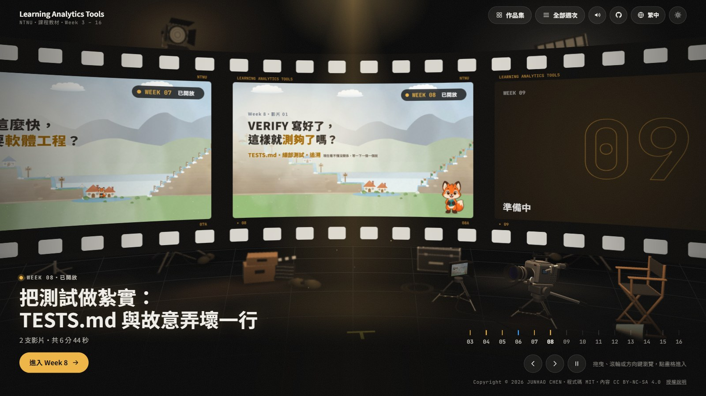
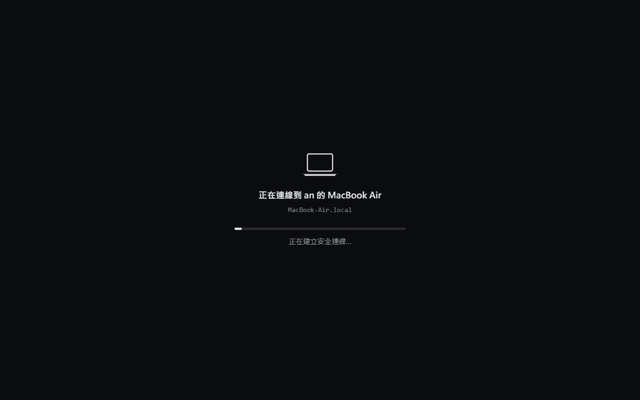
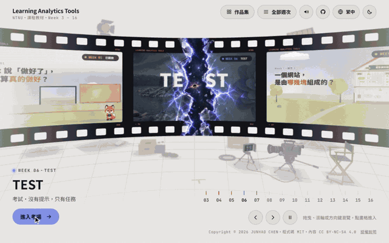

# Learning Analytics Tools（NTNU）

### 👉 [進入網站：learning-analytics-tools.pages.dev](https://learning-analytics-tools.pages.dev/)

[Week 3](https://learning-analytics-tools.pages.dev/weeks/week03/) ・ [Week 4](https://learning-analytics-tools.pages.dev/weeks/week04/) ・ [Week 5](https://learning-analytics-tools.pages.dev/weeks/week05/) ・ [Week 6 TEST](https://learning-analytics-tools.pages.dev/weeks/week06/) ・ [Week 7](https://learning-analytics-tools.pages.dev/weeks/week07/) ・ [作品集](https://learning-analytics-tools.pages.dev/works/) ・ 練習電腦 [Mac](https://learning-analytics-tools.pages.dev/lab/mac/) / [Windows](https://learning-analytics-tools.pages.dev/lab/win/)

[](https://learning-analytics-tools.pages.dev/)

臺師大「學習分析工具」的課程網站：每週幾支短影片，配上章節和重點，學生課後可以自己回來看。授課教師規劃內容、審核每一支影片；網站和影片的開發由 Codex 與 Claude 協力完成，影片做好後也由兩者互相審查。

繁體中文 ｜ [English](#english)

## 網站上有什麼

- **每週影片**：Week 3–5 已開放 10 支影片和 6 支補充；Week 7 先開放 2 支補充，影片和作業陸續加入。之後的週次依課程進度上線。影片沒有旁白，用動畫和字卡講，每支 1–5 分鐘。
- **考試（Week 6）**：首頁的「TEST」入口。連到一台遠端電腦（Mac 或 Windows），沒有提示，只有任務，一關一關靠自己完成。
- **練習電腦**：在瀏覽器裡的模擬 Mac／Windows，每週同一台、換那週的任務，照任務卡動手做，弄壞了重來就好。
- **作品集**：學生同意公開的作業網頁。
- 不用登入、不用 cookie，觀看進度只存在自己的瀏覽器。網站只用 Cloudflare Web Analytics 統計各頁的瀏覽次數，不辨識個人。介面有繁中、简中、English、Tiếng Việt，深淺色都可以。

<table>
<tr>
<td width="50%"></td>
<td width="50%"></td>
</tr>
<tr>
<td><b>練習電腦</b>：選任務，照任務卡在終端機走一遍，做對的步驟打綠勾</td>
<td><b>Week 6 考試</b>：進入考場、掉進黑洞、選一台電腦，然後 WARNING</td>
</tr>
</table>

## 影片

| 週 | 影片 | 長度 |
|---|---|---|
| Week 3 | [01 report.md 的旅程](https://learning-analytics-tools.pages.dev/weeks/week03/#01-report-journey) | 1:33 |
| | [02 AGENTS.md 與上下文管理](https://learning-analytics-tools.pages.dev/weeks/week03/#02-agents-md-context) | 3:40 |
| | [03 作業：佛羅倫斯美術館資料收集](https://learning-analytics-tools.pages.dev/weeks/week03/#03-homework-firenze) | 2:55 |
| | [補充 1 終端機介紹（Mac）](https://learning-analytics-tools.pages.dev/weeks/week03/#s1-terminal-mac)・[補充 2（Windows）](https://learning-analytics-tools.pages.dev/weeks/week03/#s2-terminal-win) | 5:14・5:23 |
| Week 4 | [01 AI Agent 內建瀏覽器](https://learning-analytics-tools.pages.dev/weeks/week04/#01-built-in-browser) | 2:28 |
| | [02 內建瀏覽器的三件事：看、改、查](https://learning-analytics-tools.pages.dev/weeks/week04/#02-browser-uses) | 2:52 |
| | [03 作業：東京銀杏散步地圖網站](https://learning-analytics-tools.pages.dev/weeks/week04/#03-homework-ginkgo) | 2:27 |
| | [04 作業：GitHub、Mermaid、內建瀏覽器](https://learning-analytics-tools.pages.dev/weeks/week04/#04-homework-github) | 3:23 |
| | [補充 1 GitHub 入門](https://learning-analytics-tools.pages.dev/weeks/week04/#s1-github)・[補充 2 Mermaid 流程圖](https://learning-analytics-tools.pages.dev/weeks/week04/#s2-mermaid) | 3:42・4:10 |
| Week 5 | [01 怎樣才算做好：驗證清單](https://learning-analytics-tools.pages.dev/weeks/week05/#01-verify-md) | 3:24 |
| | [02 不要一直換模型](https://learning-analytics-tools.pages.dev/weeks/week05/#02-model-switch) | 1:30 |
| | [03 作業：成績分析小報告](https://learning-analytics-tools.pages.dev/weeks/week05/#03-homework-grades) | 2:29 |
| | [補充 1 按下 Enter 之後](https://learning-analytics-tools.pages.dev/weeks/week05/#s1-codex-loop)・[補充 2 對話滿了會怎樣](https://learning-analytics-tools.pages.dev/weeks/week05/#s2-context-full) | 3:44・2:35 |
| Week 6 | [TEST：考試](https://learning-analytics-tools.pages.dev/weeks/week06/)（不是影片，是連到遠端電腦的考試） | — |
| Week 7 | [補充 1 網站是怎麼組成的](https://learning-analytics-tools.pages.dev/weeks/week07/#s1-website-modules)・[補充 2 Git：版本管理，也是你的安全網](https://learning-analytics-tools.pages.dev/weeks/week07/#s2-git-versions) | 5:00・3:48 |

## 怎麼做的

- **分工**：教師提供教材、決定方向，每一輪都審核。網站和影片的開發由 Codex 與 Claude 協力完成。
- **畫面和聲音都是程式**：畫面用 HTML、CSS、JavaScript 寫成，逐格渲染成影片；配樂和音效也用程式合成。沒有用影片生成模型。
- **互相審查**：影片做好後，由 Codex 與 Claude 互相審查流程、教學是否清楚和畫面細節，教師最後確認才上線。

詳細流程、學到的經驗和完整說明在 [docs/about.md](docs/about.md)。

## 用在自己的課程

網站是純 HTML、CSS、JavaScript，不用建置，可以直接 fork：

```bash
git clone https://github.com/bigmoumou/Learning-Analytics-Tools.git
cd Learning-Analytics-Tools
python -m http.server 8000
```

影片的串流檔不在這個 repo，放在另一個 Cloudflare 專案（影片站），所以 fork 之後影片會從本課程的影片站播放。換成自己的影片時，要改 `assets/video.js` 裡的 `MEDIA`。要改哪些地方、怎麼新增影片，見 [docs/維護說明.md](docs/維護說明.md)。

## 接下來

- [ ] Week 7 的影片和作業；Week 8–16 依課程進度上線
- [ ] 全英文版影片：畫面上的字和字卡都改成英文（目前影片裡是繁體中文，網站介面、章節和重點已經有英文）
- [ ] Claude 版影片：同樣的內容，改用 Claude（Claude Code）示範（目前影片示範的工具是 Codex）
- [ ] 整理並公開製作用的 prompt（每支影片的 `brief.md`、動態素材規格）和製作經驗

## 授權

- 程式：[MIT](LICENSE)
- 影片與教材：[CC BY-NC-SA 4.0](LICENSE-CONTENT.md)（標示出處、非商業使用、改作後相同方式分享）
- 學生作品：著作權屬於學生本人
- 第三方元件與圖片：見 [NOTICE.md](NOTICE.md)

引用見 [CITATION.cff](CITATION.cff)。問題和建議請開 [Issue](https://github.com/bigmoumou/Learning-Analytics-Tools/issues)，請不要寫出學生的姓名或學號。

感謝修課的同學。網站和影片是教師與 [Codex](https://openai.com/codex/)（OpenAI）、[Claude Code](https://claude.com/claude-code)（Anthropic）協力完成，使用 opus-video skill（周行 Kianzzz，MIT）、HyperFrames、hls.js 等工具。維護者：JUNHAO CHEN（[@bigmoumou](https://github.com/bigmoumou)）。

---

## English

### 👉 [Open the site: learning-analytics-tools.pages.dev](https://learning-analytics-tools.pages.dev/)

Course site for Learning Analytics Tools at National Taiwan Normal University: a few short videos each week with chapters and key points, for students to review at their own pace. The teacher plans the content and reviews every video. The site and the videos are developed by Codex and Claude working together, and each finished video is reviewed by both of them. The site interface is available in English; the text inside the videos is Traditional Chinese.

- **Videos**: Weeks 3–5 are open (10 videos and 6 extras), and Week 7 has opened with 2 extras; its videos and homework come next, and later weeks follow the course. No narration, 1–5 minutes each.
- **Test (Week 6)**: the "TEST" entrance on the homepage. You connect to a remote computer (Mac or Windows) and complete the tasks one level at a time, with no hints.
- **Practice computers**: a simulated Mac or Windows PC in the browser, with step-by-step missions.
- **Showcase**: student homework pages shared with their permission.
- No login and no cookies; watch progress stays in your own browser. The site uses Cloudflare Web Analytics only to count page views, without identifying anyone.

<table>
<tr>
<td width="50%"></td>
<td width="50%"></td>
</tr>
<tr>
<td><b>Practice computer</b>: pick a mission and follow the card in the terminal; each step done gets a green tick</td>
<td><b>Week 6 test</b>: enter the test, fall into a black hole, pick a computer, then WARNING</td>
</tr>
</table>

**How it is made**: the visuals are written in HTML, CSS and JavaScript and rendered frame by frame; the music and sound effects are synthesized in code too, and no video-generation model is used. Codex and Claude review each other's videos, and the teacher gives the final approval.

**Next**

- [ ] Week 7 videos and homework; Weeks 8–16 as the course goes on
- [ ] Full English versions of the videos, with English on-screen text (the site, chapters and key points are already in English)
- [ ] Claude versions of the videos: the same lessons, demonstrated with Claude (Claude Code) instead of Codex
- [ ] Release the production prompts (each video's `brief.md` and the animation specs) and the lessons learned

Run it locally with `python -m http.server 8000`. The video streams are hosted on a separate Cloudflare project, so a fork plays them from this course's media site; change `MEDIA` in `assets/video.js` to use your own. Code: [MIT](LICENSE). Videos and course content: [CC BY-NC-SA 4.0](LICENSE-CONTENT.md). Student work belongs to the students. Third-party notices: [NOTICE.md](NOTICE.md). Full details: [docs/about.md](docs/about.md).
