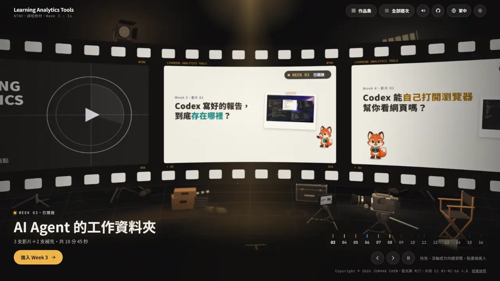

<h1 align="center">AI Agent Literacy</h1>

<p align="center">
An open course on working with AI coding agents<br>
<sub>First piloted at National Taiwan Normal University, 2026</sub>
</p>

<p align="center">
<a href="https://ai-agent-literacy.pages.dev/"></a>
</p>

<p align="center">
<a href="#educational-design">Educational design</a> ·
<a href="#videos">Videos</a> ·
<a href="#how-its-made">How it's made</a> ·
<a href="#license-and-citation">Cite</a>
<br>
<b>English</b> · <a href="#zh-tw">繁體中文</a> · <a href="#zh-cn">简体中文</a> · <a href="#ja">日本語</a>
</p>

[](https://ai-agent-literacy.pages.dev/)

**An example of AI demonstration teaching.** AI Agent Literacy teaches students to work with AI coding agents such as OpenAI Codex, and its own materials are made the same way. The teaching videos, the course site and the practice environment were developed with AI agents (Codex and Claude); the teacher designed the curriculum, supplied the content and reviewed every video. Students see what to do with AI and, in the materials themselves, how a complete piece of work gets made with it. Everything is published as an open course under open licenses.

<table>
<tr><td><b>Pilot site</b></td><td>National Taiwan Normal University (NTNU), 2026, in the course <i>Learning Analytics Tools Implementation Applications</i></td></tr>
<tr><td><b>Format</b></td><td>Weekly microlearning videos (1–5 min) with chapters and key points; a browser-based practice computer; a scenario-based exam</td></tr>
<tr><td><b>Published</b></td><td>Weeks 1 and 3–8: 27 videos, about 85 minutes (October 2026), updated weekly</td></tr>
<tr><td><b>Languages</b></td><td>Site in English, Traditional Chinese, Simplified Chinese and Vietnamese, chosen from the browser's language. Weeks 3–7 are fully in English too: every video, the practice computers and the Week 6 exam. Other videos show Traditional Chinese on screen</td></tr>
<tr><td><b>Licenses</b></td><td>Code <a href="LICENSE">MIT</a>; videos and course content <a href="LICENSE-CONTENT.md">CC BY-NC-SA 4.0</a></td></tr>
</table>

<table>
<tr>
<td width="50%"></td>
<td width="50%"></td>
</tr>
<tr>
<td align="center"><b>Virtual Remote Practice</b></td>
<td align="center"><b>Scenario-Based Exam Practice</b></td>
</tr>
</table>

## Educational design

- **Microlearning for self-paced review.** Each video covers one idea in 1–5 minutes and is segmented into chapters with numbered key points. A time link (`#t=30`) takes students to the exact moment a teacher wants them to revisit.
- **Worked examples and common errors.** Homework videos first show a typical mistake, such as pasting the whole assignment into the AI or trusting a confident but wrong average, and then walk through a better process.
- **Simulation-based practice.** A simulated Mac or Windows computer runs in the browser as a virtual lab. Guided missions give immediate feedback on every step, and nothing is saved, so students can make mistakes safely and start again.
- **Scenario-based assessment.** The Week 6 exam places students in a story on a remote computer. With no hints, they complete levels that mirror the work of the earlier weeks: moving around folders in the terminal, writing `AGENTS.md` and `VERIFY.md` for an AI agent, and a closing quiz.
- **Authentic, project-based homework.** Each assignment ends in a real deliverable pushed to GitHub: a museum data collection, a walking-map website, a grade report, a small game.
- **Human-in-the-loop habits for AI-assisted work.** Verification checklists, test-driven development, planning documents (`PLANS.md`, `TESTS.md`) and version control teach students to direct, check and correct an AI agent rather than accept its output. This is the AI literacy the course aims for.
- **Access and privacy by default.** Four interface languages, light and dark themes, screen-reader labels and reduced-motion support. No login, no cookies and no tracking of individuals; watch progress stays in the student's own browser.

## Videos

| Week | Video | Length |
|---|---|---|
| Week 1 | [01 AI Can Do the Work Itself Now. What Should We Learn? AI Agent Literacy](https://ai-agent-literacy.pages.dev/weeks/week01/?lang=en#01-agent-literacy) | 2:08 |
| | [02 How Do You Learn Best in This Course? Tools, Hands-on Work, Self-learning](https://ai-agent-literacy.pages.dev/weeks/week01/?lang=en#02-course-guide) | 1:51 |
| | [03 After One Instruction, What Does the AI Agent Do? From One Sentence to a Finished Page](https://ai-agent-literacy.pages.dev/weeks/week01/?lang=en#03-first-run) | 1:36 |
| Week 3 | [01 The Journey of report.md](https://ai-agent-literacy.pages.dev/weeks/week03/?lang=en#01-report-journey) | 1:33 |
| | [02 AGENTS.md and Context Management](https://ai-agent-literacy.pages.dev/weeks/week03/?lang=en#02-agents-md-context) | 3:40 |
| | [03 Homework: Collecting Florence Museum Data](https://ai-agent-literacy.pages.dev/weeks/week03/?lang=en#03-homework-firenze) | 2:55 |
| | [Extra 1 Intro to the Terminal (Mac)](https://ai-agent-literacy.pages.dev/weeks/week03/?lang=en#s1-terminal-mac) ・ [Extra 2 (Windows)](https://ai-agent-literacy.pages.dev/weeks/week03/?lang=en#s2-terminal-win) | 5:14 ・ 5:23 |
| Week 4 | [01 AI Agent Built-in Browser](https://ai-agent-literacy.pages.dev/weeks/week04/?lang=en#01-built-in-browser) | 2:28 |
| | [02 Three More Things the Built-in Browser Can Do](https://ai-agent-literacy.pages.dev/weeks/week04/?lang=en#02-browser-uses) | 2:52 |
| | [03 Homework: A Tokyo Ginkgo Walking-Map Website](https://ai-agent-literacy.pages.dev/weeks/week04/?lang=en#03-homework-ginkgo) | 2:27 |
| | [04 Homework: GitHub, Mermaid and the Built-in Browser](https://ai-agent-literacy.pages.dev/weeks/week04/?lang=en#04-homework-github) | 3:23 |
| | [Extra 1 Getting Started with GitHub](https://ai-agent-literacy.pages.dev/weeks/week04/?lang=en#s1-github) ・ [Extra 2 Mermaid Flowcharts](https://ai-agent-literacy.pages.dev/weeks/week04/?lang=en#s2-mermaid) | 3:42 ・ 4:10 |
| Week 5 | [01 What Counts as Done: a Verification Checklist](https://ai-agent-literacy.pages.dev/weeks/week05/?lang=en#01-verify-md) | 3:24 |
| | [02 Don't Keep Switching Models](https://ai-agent-literacy.pages.dev/weeks/week05/?lang=en#02-model-switch) | 1:30 |
| | [03 Homework: A Short Grade-Analysis Report](https://ai-agent-literacy.pages.dev/weeks/week05/?lang=en#03-homework-grades) | 2:29 |
| | [Extra 1 After You Press Enter](https://ai-agent-literacy.pages.dev/weeks/week05/?lang=en#s1-codex-loop) ・ [Extra 2 When the Conversation Fills Up](https://ai-agent-literacy.pages.dev/weeks/week05/?lang=en#s2-context-full) | 3:44 ・ 2:35 |
| Week 6 | [TEST](https://ai-agent-literacy.pages.dev/weeks/week06/?lang=en) (not a video: the exam on a remote computer) | — |
| Week 7 | [01 Software Engineering and Test-Driven Development (TDD)](https://ai-agent-literacy.pages.dev/weeks/week07/?lang=en#01-se-tdd) | 3:24 |
| | [02 Plan Big Tasks First: PLANS.md](https://ai-agent-literacy.pages.dev/weeks/week07/?lang=en#02-plans) | 4:08 |
| | [03 Homework: Plan and Build "Sky Island"](https://ai-agent-literacy.pages.dev/weeks/week07/?lang=en#03-homework-island) | 2:52 |
| | [Extra 1 What a Website Is Made Of](https://ai-agent-literacy.pages.dev/weeks/week07/?lang=en#s1-website-modules) ・ [Extra 2 Git: Version Control, and Your Safety Net](https://ai-agent-literacy.pages.dev/weeks/week07/?lang=en#s2-git-versions) | 3:51 ・ 2:57 |
| Week 8 | [01 Is VERIFY Enough? TESTS.md](https://ai-agent-literacy.pages.dev/weeks/week08/?lang=en#01-tests) | 3:54 |
| | [02 Mutation Testing](https://ai-agent-literacy.pages.dev/weeks/week08/?lang=en#02-break) | 2:58 |
| | [03 Hands-On Testing with User Stories](https://ai-agent-literacy.pages.dev/weeks/week08/?lang=en#03-playtest) | 3:43 |

**Topics covered**: AI coding agents (OpenAI Codex, Claude Code), working folders and the terminal, `AGENTS.md` and the context window, the built-in browser, GitHub and Mermaid, verification checklists (`VERIFY.md`), switching models mid-task (GPT-6 Luna → GPT-6.1 Sol), the Codex agent loop and automatic compaction, test-driven development, `PLANS.md` and `TESTS.md`, mutation testing and user stories.

## How it's made

- **Roles.** The teacher supplies the material, sets the direction and reviews every round. The site and the videos are developed by Codex and Claude together.
- **Video from code.** Every frame is an HTML, CSS and JavaScript page rendered to video (HTML-to-video) with HyperFrames, GSAP, Playwright and FFmpeg; music and sound effects are synthesized in code. No video-generation model is used. The workflow mainly draws on the opus-video skill, with our own changes for this course.
- **Quality review.** Each draft is checked on contact sheets, including at phone width, and scored on seven criteria (opening, readability on a phone, natural motion, visual variety, composition, sound and picture in sync, faithfulness to the source). Codex and Claude then review each other's videos, and the teacher gives the final approval. Problems the teacher finds become rules for every later video.
- **Delivery.** A static site on Cloudflare Pages; the videos stream as HLS (hls.js) from a separate Cloudflare media site.

The full workflow and the lessons learned are in [docs/about.md](docs/about.md) (Traditional Chinese and English).

## Reuse

The site is plain HTML, CSS and JavaScript with no build step, so it can be forked for another course:

```bash
git clone https://github.com/bigmoumou/AI-Agent-Literacy.git
cd AI-Agent-Literacy
python -m http.server 8000
```

The video streams live on a separate Cloudflare project, so a fork plays them from this course's media site. To use your own videos, change `MEDIA` in `assets/video.js`; [docs/維護說明.md](docs/維護說明.md) lists everything else to change.

## Roadmap

- [ ] Weeks 9–16, published as the course goes on
- [x] Full English versions of Weeks 3–7 (October 2026): every video with English on-screen text, the practice computers and the Week 6 exam; English browsers get them automatically
- [ ] English versions of the other weeks
- [ ] Claude versions of the videos: the same lessons, demonstrated with Claude (Claude Code) instead of Codex
- [ ] Open-source the teaching-video skill (based mainly on opus-video, with our own changes), with the production prompts and the lessons learned

## License and citation

Code is under the [MIT License](LICENSE). Videos and course content are under [CC BY-NC-SA 4.0](LICENSE-CONTENT.md): attribution, non-commercial use, share alike. Student work belongs to each student. Third-party components and images are listed in [NOTICE.md](NOTICE.md).

To cite this work, use the **Cite this repository** button ([CITATION.cff](CITATION.cff)) or:

```bibtex
@misc{chen2026aiagentliteracy,
  author       = {Chen, Jun-Hao and Liu, Che-You},
  title        = {{AI} Agent Literacy: An Open Course on Working with {AI} Coding Agents},
  year         = {2026},
  howpublished = {\url{https://ai-agent-literacy.pages.dev/}},
  note         = {Open educational resource. Source: https://github.com/bigmoumou/AI-Agent-Literacy}
}
```

Questions and suggestions are welcome as [issues](https://github.com/bigmoumou/AI-Agent-Literacy/issues). Please do not include students' names or student IDs.

## Team and acknowledgements

- **Authors**: Jun-Hao Chen (陳俊豪, maintainer), Che-You Liu (劉哲佑), 邱嵦時
- **Teaching assistants and students**: 許家瑋 (Graduate Institute of Information and Computer Education, National Taiwan Normal University)
- **Resource support**: the [MPIPM Lab](https://shaoyiuhsu.wixsite.com/website) (Multi-Phase In Porous Medium) of [Prof. Shao-Yiu Hsu (許少瑜)](https://www.bse.ntu.edu.tw/member/teacher/syhsu), Department of Bioenvironmental Systems Engineering, National Taiwan University
- **Tools**: the site and the videos were made together with [Codex](https://openai.com/codex/) (OpenAI) and [Claude Code](https://claude.com/claude-code) (Anthropic). The video workflow mainly draws on the opus-video skill by 周行 (Kianzzz), with our own changes; we plan to open-source this teaching-video skill as well.

Thanks to the students taking the course.

---

<a name="zh-tw"></a>
<details>
<summary><b>繁體中文</b></summary>

### 課程簡介

**課程網站**：[ai-agent-literacy.pages.dev](https://ai-agent-literacy.pages.dev/)

**AI 示範教學的實例。** AI Agent Literacy（AI 代理素養）是一門開放式課程，教學生和 AI 程式助理（例如 OpenAI 的 Codex）一起工作，而課程本身的教材也是這樣做出來的：教學影片、課程網站和練習環境由 AI 代理（Codex 與 Claude）開發，授課教師設計課程、提供教材，並審核每一支影片。學生除了學到怎麼用 AI，也能從教材本身看到一件完整的作品如何和 AI 合作完成。所有內容都以開放授權公開，是一門開放式課程。

<table>
<tr><td><b>首個示範場域</b></td><td>國立臺灣師範大學（2026），課程「學習分析工具」（Learning Analytics Tools Implementation Applications）</td></tr>
<tr><td><b>形式</b></td><td>每週微學習影片（1–5 分鐘），附章節和重點；瀏覽器裡的練習電腦；情境式考試</td></tr>
<tr><td><b>已公開</b></td><td>Week 1、3–8：27 支影片，約 85 分鐘（2026 年 10 月），每週更新</td></tr>
<tr><td><b>語言</b></td><td>網站有英文、繁體中文、簡體中文、越南文，依瀏覽器語言自動選。Week 3–7 另有完整英文版：每支影片、練習電腦、Week 6 考試；其他影片畫面是繁體中文</td></tr>
<tr><td><b>授權</b></td><td>程式 <a href="LICENSE">MIT</a>；影片與教材 <a href="LICENSE-CONTENT.md">CC BY-NC-SA 4.0</a></td></tr>
</table>

### 教學設計

- **微學習與自主複習**：一支影片只講一個概念，1–5 分鐘，切成章節並附編號重點。教師可以用時間連結（`#t=30`）把學生帶到要複習的那一刻。
- **範例學習與常見錯誤**：作業影片先示範常見的錯誤，例如把整份題目貼給 AI、相信 AI 很有自信算出的錯誤平均，再一步步走過比較好的做法。
- **模擬式練習**：在瀏覽器裡執行的模擬 Mac／Windows，是一個虛擬實驗室。任務卡逐步引導，每一步都立即回饋；什麼都不會存下來，學生可以放心犯錯、隨時重來。
- **情境式評量**：Week 6 的考試把學生放進一段故事，連到一台遠端電腦。沒有提示，學生要一關一關完成任務，內容對應前幾週的實作：用終端機在資料夾間移動、替 AI 代理寫 `AGENTS.md` 和 `VERIFY.md`，最後是一段問答。
- **真實性評量與專題導向作業**：每份作業都是一件實際的成品，推上 GitHub：美術館資料收集、散步地圖網站、成績報告、一個小遊戲。
- **人機協作（human-in-the-loop）的習慣**：驗證清單、測試驅動開發、規劃文件（`PLANS.md`、`TESTS.md`）和版本管理，讓學生學會指揮、檢查並修正 AI，而不是照單全收。這就是課程想培養的 AI 素養。
- **預設就顧及無障礙與隱私**：四種介面語言、深淺色主題、螢幕閱讀器標示、減少動態效果。不用登入、不用 cookie，也不追蹤個人；觀看進度只存在學生自己的瀏覽器。

### 影片

| 週 | 影片 | 長度 |
|---|---|---|
| Week 1 | [01 AI 會自己動手做事了，我們要學什麼？AI Agent Literacy](https://ai-agent-literacy.pages.dev/weeks/week01/#01-agent-literacy) | 2:08 |
| | [02 這門課要怎麼上，才學得最好？工具、實作、自學](https://ai-agent-literacy.pages.dev/weeks/week01/#02-course-guide) | 1:51 |
| | [03 交代一句話之後，AI Agent 做了什麼？從一句話到成品](https://ai-agent-literacy.pages.dev/weeks/week01/#03-first-run) | 1:36 |
| Week 3 | [01 report.md 的旅程](https://ai-agent-literacy.pages.dev/weeks/week03/#01-report-journey) | 1:33 |
| | [02 AGENTS.md 與上下文管理](https://ai-agent-literacy.pages.dev/weeks/week03/#02-agents-md-context) | 3:40 |
| | [03 作業：佛羅倫斯美術館資料收集](https://ai-agent-literacy.pages.dev/weeks/week03/#03-homework-firenze) | 2:55 |
| | [補充 1 終端機介紹（Mac）](https://ai-agent-literacy.pages.dev/weeks/week03/#s1-terminal-mac)・[補充 2（Windows）](https://ai-agent-literacy.pages.dev/weeks/week03/#s2-terminal-win) | 5:14・5:23 |
| Week 4 | [01 AI Agent 內建瀏覽器](https://ai-agent-literacy.pages.dev/weeks/week04/#01-built-in-browser) | 2:28 |
| | [02 內建瀏覽器的三件事：看、改、查](https://ai-agent-literacy.pages.dev/weeks/week04/#02-browser-uses) | 2:52 |
| | [03 作業：東京銀杏散步地圖網站](https://ai-agent-literacy.pages.dev/weeks/week04/#03-homework-ginkgo) | 2:27 |
| | [04 作業：GitHub、Mermaid、內建瀏覽器](https://ai-agent-literacy.pages.dev/weeks/week04/#04-homework-github) | 3:23 |
| | [補充 1 GitHub 入門](https://ai-agent-literacy.pages.dev/weeks/week04/#s1-github)・[補充 2 Mermaid 流程圖](https://ai-agent-literacy.pages.dev/weeks/week04/#s2-mermaid) | 3:42・4:10 |
| Week 5 | [01 怎樣才算做好：驗證清單](https://ai-agent-literacy.pages.dev/weeks/week05/#01-verify-md) | 3:24 |
| | [02 不要一直換模型](https://ai-agent-literacy.pages.dev/weeks/week05/#02-model-switch) | 1:30 |
| | [03 作業：成績分析小報告](https://ai-agent-literacy.pages.dev/weeks/week05/#03-homework-grades) | 2:29 |
| | [補充 1 按下 Enter 之後](https://ai-agent-literacy.pages.dev/weeks/week05/#s1-codex-loop)・[補充 2 對話滿了會怎樣](https://ai-agent-literacy.pages.dev/weeks/week05/#s2-context-full) | 3:44・2:35 |
| Week 6 | [TEST](https://ai-agent-literacy.pages.dev/weeks/week06/)（不是影片，是連到遠端電腦的考試） | — |
| Week 7 | [01 軟體工程與測試驅動開發（TDD）](https://ai-agent-literacy.pages.dev/weeks/week07/#01-se-tdd) | 3:24 |
| | [02 大任務，先規劃：PLANS.md](https://ai-agent-literacy.pages.dev/weeks/week07/#02-plans) | 4:08 |
| | [03 作業：規劃並做出「空中之島」](https://ai-agent-literacy.pages.dev/weeks/week07/#03-homework-island) | 2:52 |
| | [補充 1 網站是怎麼組成的](https://ai-agent-literacy.pages.dev/weeks/week07/#s1-website-modules)・[補充 2 Git：版本管理，也是你的安全網](https://ai-agent-literacy.pages.dev/weeks/week07/#s2-git-versions) | 3:51・2:57 |
| Week 8 | [01 VERIFY 就夠了嗎？TESTS.md](https://ai-agent-literacy.pages.dev/weeks/week08/#01-tests) | 3:54 |
| | [02 突變測試（Mutation Testing）](https://ai-agent-literacy.pages.dev/weeks/week08/#02-break) | 2:58 |
| | [03 透過 User Story 幫助實測](https://ai-agent-literacy.pages.dev/weeks/week08/#03-playtest) | 3:43 |

**涵蓋主題**：AI 程式助理（OpenAI Codex、Claude Code）、工作資料夾與終端機、`AGENTS.md` 與 context window、內建瀏覽器、GitHub 與 Mermaid、驗證清單（`VERIFY.md`）、做到一半換模型（GPT-6 Luna → GPT-6.1 Sol）、Codex 的 agent loop 與自動壓縮、測試驅動開發、`PLANS.md` 與 `TESTS.md`、突變測試（mutation testing）與 user story。

### 怎麼做的

- **分工**：教師提供教材、決定方向，每一輪都審核。網站和影片的開發由 Codex 與 Claude 協力完成。
- **用程式做影片**：每一格畫面都是 HTML、CSS、JavaScript 寫成的網頁，用 HyperFrames、GSAP、Playwright、FFmpeg 逐格渲染成影片；配樂和音效也用程式合成。沒有用影片生成模型。製作流程主要參考 opus-video skill，再依課程需求做了個人化修改。
- **品質審查**：每一版都看縮圖總表（包括手機寬度），依開場、手機可讀、動作自然、畫面變化、構圖、音畫同步、貼合原始教材七項評分。接著由 Codex 與 Claude 互相審查，教師最後確認才上線。教師指出的問題，會寫成之後每支影片都要遵守的規則。
- **網站**：純靜態網站，放在 Cloudflare Pages；影片用 HLS（hls.js）從另一個 Cloudflare 影片站播放。

詳細流程和學到的經驗在 [docs/about.md](docs/about.md)。

### 沿用到其他課程

網站是純 HTML、CSS、JavaScript，不用建置，可以直接 fork：

```bash
git clone https://github.com/bigmoumou/AI-Agent-Literacy.git
cd AI-Agent-Literacy
python -m http.server 8000
```

影片串流檔放在另一個 Cloudflare 專案，所以 fork 之後影片會從本課程的影片站播放。換成自己的影片時，改 `assets/video.js` 的 `MEDIA`；其他要改的地方見 [docs/維護說明.md](docs/維護說明.md)。

### 接下來

- [ ] Week 9–16 依課程進度上線
- [x] Week 3–7 全英文版（2026 年 10 月）：每支影片的畫面和字卡、練習電腦、Week 6 考試；英文瀏覽器自動切換
- [ ] 其他週次的英文版
- [ ] Claude 版影片：同樣的內容，改用 Claude（Claude Code）示範（目前示範的工具是 Codex）
- [ ] 開源這套教學影片 skill（主要參考 opus-video，再做個人化修改），以及製作用的 prompt 和製作經驗

### 授權與引用

程式以 [MIT](LICENSE) 授權；影片與教材以 [CC BY-NC-SA 4.0](LICENSE-CONTENT.md) 授權（標示出處、非商業使用、改作後相同方式分享）。學生作品的著作權屬於學生本人；第三方元件與圖片見 [NOTICE.md](NOTICE.md)。

引用時請用 GitHub 右側的 **Cite this repository**（[CITATION.cff](CITATION.cff)），或上方英文段的 BibTeX。問題和建議請開 [Issue](https://github.com/bigmoumou/AI-Agent-Literacy/issues)，請不要寫出學生的姓名或學號。

### 團隊與致謝

- **作者**：陳俊豪（維護者）、劉哲佑、邱嵦時
- **參與助教與學生**：許家瑋（國立臺灣師範大學資訊教育研究所）
- **資源支援**：感謝國立臺灣大學生物環境系統工程學系[許少瑜教授](https://www.bse.ntu.edu.tw/member/teacher/syhsu)的 [MPIPM 研究室](https://shaoyiuhsu.wixsite.com/website)（孔隙介質多相流研究室）提供資源支援
- **工具**：網站和影片與 [Codex](https://openai.com/codex/)（OpenAI）、[Claude Code](https://claude.com/claude-code)（Anthropic）協力完成。影片的製作流程主要參考周行（Kianzzz）的 opus-video skill，再依課程需求做了個人化修改；這套教學影片 skill 之後也會開源。

感謝修課的同學。

</details>

<a name="zh-cn"></a>
<details>
<summary><b>简体中文</b></summary>

### 课程简介

**课程网站**：[ai-agent-literacy.pages.dev](https://ai-agent-literacy.pages.dev/?lang=zh-Hans)

**AI 示范教学的实例。** AI Agent Literacy（AI 智能体素养）是一门开放课程，教学生和 AI 编程助手（例如 OpenAI 的 Codex）一起工作，而课程本身的教材也是这样做出来的：教学视频、课程网站和练习环境由 AI 智能体（Codex 与 Claude）开发，授课教师设计课程、提供教材，并审核每一个视频。学生除了学到怎么用 AI，也能从教材本身看到一件完整的作品如何与 AI 合作完成。所有内容都以开放许可公开，是一门开放课程。

<table>
<tr><td><b>首个示范场域</b></td><td>台湾师范大学（2026），课程“学习分析工具”（Learning Analytics Tools Implementation Applications）</td></tr>
<tr><td><b>形式</b></td><td>每周微学习视频（1–5 分钟），附章节和要点；浏览器里的练习电脑；情境式考试</td></tr>
<tr><td><b>已公开</b></td><td>Week 1、3–8：27 个视频，约 85 分钟（2026 年 10 月），每周更新</td></tr>
<tr><td><b>语言</b></td><td>网站有英文、繁体中文、简体中文、越南文，按浏览器语言自动选择。Week 3–7 另有完整英文版：每个视频、练习电脑、Week 6 考试；其他视频画面是繁体中文</td></tr>
<tr><td><b>许可</b></td><td>代码 <a href="LICENSE">MIT</a>；视频与教材 <a href="LICENSE-CONTENT.md">CC BY-NC-SA 4.0</a></td></tr>
</table>

### 教学设计

- **微学习与自主复习**：一个视频只讲一个概念，1–5 分钟，分成章节并附编号要点。教师可以用时间链接（`#t=30`）把学生带到要复习的那一刻。
- **样例学习与常见错误**：作业视频先演示常见的错误，例如把整份题目贴给 AI、相信 AI 很有把握算出的错误平均值，再一步步走过更好的做法。
- **基于模拟的练习**：在浏览器里运行的模拟 Mac／Windows，是一个虚拟实验室。任务卡逐步引导，每一步都即时反馈；什么都不会保存，学生可以放心犯错、随时重来。
- **情境式评价**：Week 6 的考试把学生放进一段故事，连接到一台远程电脑。没有提示，学生要一关一关完成任务，内容对应前几周的实践：用终端在文件夹之间移动、为 AI 智能体写 `AGENTS.md` 和 `VERIFY.md`，最后是一段问答。
- **真实性评价与项目式作业**：每份作业都是一件真实的成品，推送到 GitHub：美术馆数据收集、散步地图网站、成绩报告、一个小游戏。
- **人在回路（human-in-the-loop）的习惯**：验证清单、测试驱动开发、规划文档（`PLANS.md`、`TESTS.md`）和版本管理，让学生学会指挥、检查并修正 AI，而不是全盘接受。这就是课程想培养的 AI 素养。
- **默认兼顾无障碍与隐私**：四种界面语言、深浅色主题、屏幕阅读器标注、减少动态效果。不用登录、不用 cookie，也不追踪个人；观看进度只保存在学生自己的浏览器。

### 视频

| 周 | 视频 | 时长 |
|---|---|---|
| Week 1 | [01 AI 会自己动手做事了，我们要学什么？AI Agent Literacy](https://ai-agent-literacy.pages.dev/weeks/week01/?lang=zh-Hans#01-agent-literacy) | 2:08 |
| | [02 这门课要怎么上，才学得最好？工具、动手做、自学](https://ai-agent-literacy.pages.dev/weeks/week01/?lang=zh-Hans#02-course-guide) | 1:51 |
| | [03 交代一句话之后，AI Agent 做了什么？从一句话到成品](https://ai-agent-literacy.pages.dev/weeks/week01/?lang=zh-Hans#03-first-run) | 1:36 |
| Week 3 | [01 report.md 的旅程](https://ai-agent-literacy.pages.dev/weeks/week03/?lang=zh-Hans#01-report-journey) | 1:33 |
| | [02 AGENTS.md 与上下文管理](https://ai-agent-literacy.pages.dev/weeks/week03/?lang=zh-Hans#02-agents-md-context) | 3:40 |
| | [03 作业：佛罗伦萨美术馆数据收集](https://ai-agent-literacy.pages.dev/weeks/week03/?lang=zh-Hans#03-homework-firenze) | 2:55 |
| | [补充 1 终端介绍（Mac）](https://ai-agent-literacy.pages.dev/weeks/week03/?lang=zh-Hans#s1-terminal-mac)・[补充 2（Windows）](https://ai-agent-literacy.pages.dev/weeks/week03/?lang=zh-Hans#s2-terminal-win) | 5:14・5:23 |
| Week 4 | [01 AI Agent 内置浏览器](https://ai-agent-literacy.pages.dev/weeks/week04/?lang=zh-Hans#01-built-in-browser) | 2:28 |
| | [02 内置浏览器的三件事：看、改、查](https://ai-agent-literacy.pages.dev/weeks/week04/?lang=zh-Hans#02-browser-uses) | 2:52 |
| | [03 作业：东京银杏散步地图网站](https://ai-agent-literacy.pages.dev/weeks/week04/?lang=zh-Hans#03-homework-ginkgo) | 2:27 |
| | [04 作业：GitHub、Mermaid、内置浏览器](https://ai-agent-literacy.pages.dev/weeks/week04/?lang=zh-Hans#04-homework-github) | 3:23 |
| | [补充 1 GitHub 入门](https://ai-agent-literacy.pages.dev/weeks/week04/?lang=zh-Hans#s1-github)・[补充 2 Mermaid 流程图](https://ai-agent-literacy.pages.dev/weeks/week04/?lang=zh-Hans#s2-mermaid) | 3:42・4:10 |
| Week 5 | [01 怎样才算做好：验证清单](https://ai-agent-literacy.pages.dev/weeks/week05/?lang=zh-Hans#01-verify-md) | 3:24 |
| | [02 不要一直换模型](https://ai-agent-literacy.pages.dev/weeks/week05/?lang=zh-Hans#02-model-switch) | 1:30 |
| | [03 作业：成绩分析小报告](https://ai-agent-literacy.pages.dev/weeks/week05/?lang=zh-Hans#03-homework-grades) | 2:29 |
| | [补充 1 按下 Enter 之后](https://ai-agent-literacy.pages.dev/weeks/week05/?lang=zh-Hans#s1-codex-loop)・[补充 2 对话满了会怎样](https://ai-agent-literacy.pages.dev/weeks/week05/?lang=zh-Hans#s2-context-full) | 3:44・2:35 |
| Week 6 | [TEST](https://ai-agent-literacy.pages.dev/weeks/week06/?lang=zh-Hans)（不是视频，是连接到远程电脑的考试） | — |
| Week 7 | [01 软件工程与测试驱动开发（TDD）](https://ai-agent-literacy.pages.dev/weeks/week07/?lang=zh-Hans#01-se-tdd) | 3:24 |
| | [02 大任务，先规划：PLANS.md](https://ai-agent-literacy.pages.dev/weeks/week07/?lang=zh-Hans#02-plans) | 4:08 |
| | [03 作业：规划并做出“空中之岛”](https://ai-agent-literacy.pages.dev/weeks/week07/?lang=zh-Hans#03-homework-island) | 2:52 |
| | [补充 1 网站是怎么组成的](https://ai-agent-literacy.pages.dev/weeks/week07/?lang=zh-Hans#s1-website-modules)・[补充 2 Git：版本管理，也是你的安全网](https://ai-agent-literacy.pages.dev/weeks/week07/?lang=zh-Hans#s2-git-versions) | 3:51・2:57 |
| Week 8 | [01 VERIFY 就够了吗？TESTS.md](https://ai-agent-literacy.pages.dev/weeks/week08/?lang=zh-Hans#01-tests) | 3:54 |
| | [02 突变测试（Mutation Testing）](https://ai-agent-literacy.pages.dev/weeks/week08/?lang=zh-Hans#02-break) | 2:58 |
| | [03 通过 User Story 帮助实测](https://ai-agent-literacy.pages.dev/weeks/week08/?lang=zh-Hans#03-playtest) | 3:43 |

**涵盖主题**：AI 编程助手（OpenAI Codex、Claude Code）、工作文件夹与终端、`AGENTS.md` 与上下文窗口、内置浏览器、GitHub 与 Mermaid、验证清单（`VERIFY.md`）、做到一半换模型（GPT-6 Luna → GPT-6.1 Sol）、Codex 的 agent loop 与自动压缩、测试驱动开发、`PLANS.md` 与 `TESTS.md`、突变测试（mutation testing）与 user story。

### 怎么做的

- **分工**：教师提供教材、决定方向，每一轮都审核。网站和视频的开发由 Codex 与 Claude 协作完成。
- **用代码做视频**：每一帧画面都是 HTML、CSS、JavaScript 写成的网页，用 HyperFrames、GSAP、Playwright、FFmpeg 逐帧渲染成视频；配乐和音效也用代码合成。没有使用视频生成模型。制作流程主要参考 opus-video skill，再根据课程需求做了个性化修改。
- **质量审查**：每一版都看缩略图总表（包括手机宽度），按开场、手机可读、动作自然、画面变化、构图、音画同步、贴合原始教材七项评分。然后由 Codex 与 Claude 互相审查，教师最后确认才上线。教师指出的问题，会写成之后每个视频都要遵守的规则。
- **网站**：纯静态网站，部署在 Cloudflare Pages；视频以 HLS（hls.js）从另一个 Cloudflare 视频站播放。

完整说明见 [docs/about.md](docs/about.md)（繁体中文、英文）。

### 用于其他课程

网站是纯 HTML、CSS、JavaScript，不需要构建，可以直接 fork：

```bash
git clone https://github.com/bigmoumou/AI-Agent-Literacy.git
cd AI-Agent-Literacy
python -m http.server 8000
```

视频流媒体文件放在另一个 Cloudflare 项目，所以 fork 之后视频会从本课程的视频站播放。换成自己的视频时，修改 `assets/video.js` 的 `MEDIA`；其他需要修改的地方见 [docs/維護說明.md](docs/維護說明.md)（繁体中文）。

### 接下来

- [ ] Week 9–16 按课程进度上线
- [x] Week 3–7 全英文版（2026 年 10 月）：每个视频的画面和字卡、练习电脑、Week 6 考试；英文浏览器自动切换
- [ ] 其他周次的英文版
- [ ] Claude 版视频：同样的内容，改用 Claude（Claude Code）演示（目前演示的工具是 Codex）
- [ ] 开源这套教学视频 skill（主要参考 opus-video，再做个性化修改），以及制作用的 prompt 和制作经验

### 许可与引用

代码采用 [MIT](LICENSE) 许可；视频与教材采用 [CC BY-NC-SA 4.0](LICENSE-CONTENT.md) 许可（署名、非商业性使用、相同方式共享）。学生作品的著作权属于学生本人；第三方组件与图片见 [NOTICE.md](NOTICE.md)。

引用时请使用 GitHub 右侧的 **Cite this repository**（[CITATION.cff](CITATION.cff)），或上方英文部分的 BibTeX。问题和建议请开 [Issue](https://github.com/bigmoumou/AI-Agent-Literacy/issues)，请不要写出学生的姓名或学号。

### 团队与致谢

- **作者**：陈俊豪（维护者）、刘哲佑、邱嵦时
- **参与助教与学生**：许家玮（台湾师范大学资讯教育研究所）
- **资源支持**：感谢台湾大学生物环境系统工程学系[许少瑜教授](https://www.bse.ntu.edu.tw/member/teacher/syhsu)的 [MPIPM 研究室](https://shaoyiuhsu.wixsite.com/website)（孔隙介质多相流研究室）提供资源支持
- **工具**：网站和视频与 [Codex](https://openai.com/codex/)（OpenAI）、[Claude Code](https://claude.com/claude-code)（Anthropic）协作完成。视频的制作流程主要参考周行（Kianzzz）的 opus-video skill，再根据课程需求做了个性化修改；这套教学视频 skill 之后也会开源。

感谢修课的同学。

</details>

<a name="ja"></a>
<details>
<summary><b>日本語</b></summary>

### 概要

**コースサイト**：[ai-agent-literacy.pages.dev](https://ai-agent-literacy.pages.dev/)

**AI デモンストレーション教育の実践例。** AI Agent Literacy（AI エージェント・リテラシー）は、OpenAI の Codex などの AI コーディングエージェントと協働する方法を教えるオープンコースです。授業の教材そのものも同じ方法で作られています。教育動画・コースサイト・練習環境は AI エージェント（Codex と Claude）が開発し、担当教員がカリキュラムを設計して教材を用意し、すべての動画をレビューしました。学生は AI の使い方を学ぶと同時に、教材そのものを通して、AI と協働してひとつの作品を完成させる過程を見ることができます。すべてオープンライセンスで公開しているオープンコースです。

<table>
<tr><td><b>最初の実践の場</b></td><td>国立台湾師範大学（2026 年）、授業「学習分析ツール」（Learning Analytics Tools Implementation Applications）</td></tr>
<tr><td><b>形式</b></td><td>毎週のマイクロラーニング動画（1〜5 分、チャプターと要点つき）、ブラウザ上の練習用コンピューター、シナリオ型の試験</td></tr>
<tr><td><b>公開済み</b></td><td>Week 1・3〜8：動画 27 本、約 85 分（2026 年 10 月時点）、毎週更新</td></tr>
<tr><td><b>言語</b></td><td>サイトは英語・繁体字中国語・簡体字中国語・ベトナム語（日本語は未対応）で、ブラウザの言語で自動選択。Week 3〜7 は動画・練習用コンピュータ・Week 6 の試験まで完全な英語版あり。その他の動画内の文字は繁体字中国語</td></tr>
<tr><td><b>ライセンス</b></td><td>コード <a href="LICENSE">MIT</a>、動画と教材 <a href="LICENSE-CONTENT.md">CC BY-NC-SA 4.0</a></td></tr>
</table>

### 教育デザイン

- **マイクロラーニングと自己ペースの復習**：1 本の動画で扱うのはひとつの概念だけ。1〜5 分で、チャプターと番号つきの要点に分けています。教員はタイムリンク（`#t=30`）で、学生に見直してほしい場面へ直接案内できます。
- **例題学習とよくある間違い**：課題の動画では、まず課題文をまるごと AI に貼りつける、AI が自信ありげに出した誤った平均値を信じる、といったよくある間違いを見せてから、よりよい進め方を順を追って示します。
- **シミュレーション型の練習**：ブラウザ上で動く Mac／Windows のシミュレーターがバーチャルラボになっています。課題カードが一歩ずつ案内し、各ステップにすぐフィードバックが返ります。何も保存されないので、安心して失敗し、いつでもやり直せます。
- **シナリオ型評価**：Week 6 の試験では、学生はストーリーの中でリモートのコンピューターに接続します。ヒントなしで、それまでの週の実践に対応したレベルをひとつずつクリアします（ターミナルでのフォルダ移動、AI エージェントのための `AGENTS.md` と `VERIFY.md` の作成、最後のクイズ）。
- **真正の評価とプロジェクト型の課題**：どの課題も、GitHub に push する実際の成果物で終わります（美術館のデータ収集、散歩マップのサイト、成績レポート、小さなゲーム）。
- **ヒューマン・イン・ザ・ループの習慣**：検証チェックリスト、テスト駆動開発、計画文書（`PLANS.md`、`TESTS.md`）、バージョン管理を通して、AI の出力をそのまま受け入れるのではなく、指示し、確認し、修正する力を育てます。これがこの授業の目指す AI リテラシーです。
- **アクセシビリティとプライバシーを標準で**：4 つの表示言語、ライト／ダークテーマ、スクリーンリーダー向けのラベル、動きを減らす設定への対応。ログインも cookie も不要で、個人の追跡もしません。視聴の進み具合は学生自身のブラウザにだけ保存されます。

### 動画

| 週 | 動画 | 長さ |
|---|---|---|
| Week 1 | [01 AI が自分で作業する時代、何を学ぶべきか？AI Agent Literacy](https://ai-agent-literacy.pages.dev/weeks/week01/#01-agent-literacy) | 2:08 |
| | [02 この授業はどう受ければいちばん身につく？ツール・実践・自学](https://ai-agent-literacy.pages.dev/weeks/week01/#02-course-guide) | 1:51 |
| | [03 一言指示したら、AI エージェントは何をする？一言から完成まで](https://ai-agent-literacy.pages.dev/weeks/week01/#03-first-run) | 1:36 |
| Week 3 | [01 report.md の旅](https://ai-agent-literacy.pages.dev/weeks/week03/#01-report-journey) | 1:33 |
| | [02 AGENTS.md とコンテキスト管理](https://ai-agent-literacy.pages.dev/weeks/week03/#02-agents-md-context) | 3:40 |
| | [03 課題：フィレンツェの美術館データ収集](https://ai-agent-literacy.pages.dev/weeks/week03/#03-homework-firenze) | 2:55 |
| | [補足 1 ターミナル入門（Mac）](https://ai-agent-literacy.pages.dev/weeks/week03/#s1-terminal-mac)・[補足 2（Windows）](https://ai-agent-literacy.pages.dev/weeks/week03/#s2-terminal-win) | 5:14・5:23 |
| Week 4 | [01 AI エージェントの内蔵ブラウザ](https://ai-agent-literacy.pages.dev/weeks/week04/#01-built-in-browser) | 2:28 |
| | [02 内蔵ブラウザでできる 3 つのこと：見る・直す・調べる](https://ai-agent-literacy.pages.dev/weeks/week04/#02-browser-uses) | 2:52 |
| | [03 課題：東京イチョウ散歩マップのサイト](https://ai-agent-literacy.pages.dev/weeks/week04/#03-homework-ginkgo) | 2:27 |
| | [04 課題：GitHub・Mermaid・内蔵ブラウザ](https://ai-agent-literacy.pages.dev/weeks/week04/#04-homework-github) | 3:23 |
| | [補足 1 GitHub 入門](https://ai-agent-literacy.pages.dev/weeks/week04/#s1-github)・[補足 2 Mermaid でフローチャート](https://ai-agent-literacy.pages.dev/weeks/week04/#s2-mermaid) | 3:42・4:10 |
| Week 5 | [01 「できた」とは何か：検証チェックリスト](https://ai-agent-literacy.pages.dev/weeks/week05/#01-verify-md) | 3:24 |
| | [02 モデルを途中で変えない](https://ai-agent-literacy.pages.dev/weeks/week05/#02-model-switch) | 1:30 |
| | [03 課題：成績分析の小レポート](https://ai-agent-literacy.pages.dev/weeks/week05/#03-homework-grades) | 2:29 |
| | [補足 1 Enter を押したあと](https://ai-agent-literacy.pages.dev/weeks/week05/#s1-codex-loop)・[補足 2 会話がいっぱいになると](https://ai-agent-literacy.pages.dev/weeks/week05/#s2-context-full) | 3:44・2:35 |
| Week 6 | [TEST](https://ai-agent-literacy.pages.dev/weeks/week06/)（動画ではなく、リモートのコンピューターで受ける試験） | — |
| Week 7 | [01 ソフトウェア工学とテスト駆動開発（TDD）](https://ai-agent-literacy.pages.dev/weeks/week07/#01-se-tdd) | 3:24 |
| | [02 大きなタスクはまず計画：PLANS.md](https://ai-agent-literacy.pages.dev/weeks/week07/#02-plans) | 4:08 |
| | [03 課題：「空中の島」を計画して作る](https://ai-agent-literacy.pages.dev/weeks/week07/#03-homework-island) | 2:52 |
| | [補足 1 Web サイトは何でできているか](https://ai-agent-literacy.pages.dev/weeks/week07/#s1-website-modules)・[補足 2 Git：バージョン管理はセーフティネット](https://ai-agent-literacy.pages.dev/weeks/week07/#s2-git-versions) | 3:51・2:57 |
| Week 8 | [01 VERIFY だけで十分？TESTS.md](https://ai-agent-literacy.pages.dev/weeks/week08/#01-tests) | 3:54 |
| | [02 ミューテーションテスト（Mutation Testing）](https://ai-agent-literacy.pages.dev/weeks/week08/#02-break) | 2:58 |
| | [03 User Story で実際に試す](https://ai-agent-literacy.pages.dev/weeks/week08/#03-playtest) | 3:43 |

**扱うテーマ**：AI コーディングエージェント（OpenAI Codex、Claude Code）、作業フォルダとターミナル、`AGENTS.md` とコンテキストウィンドウ、内蔵ブラウザ、GitHub と Mermaid、検証チェックリスト（`VERIFY.md`）、作業途中のモデル切り替え（GPT-6 Luna → GPT-6.1 Sol）、Codex のエージェントループと自動圧縮、テスト駆動開発、`PLANS.md` と `TESTS.md`、ミューテーションテストと user story。

### 作り方

- **役割分担**：教員が教材を用意して方向を決め、毎回レビューします。サイトと動画の開発は Codex と Claude が協力して行います。
- **コードで作る動画**：すべてのフレームは HTML・CSS・JavaScript で書いた Web ページで、HyperFrames・GSAP・Playwright・FFmpeg で 1 フレームずつレンダリングしています。BGM と効果音もコードで合成しており、動画生成モデルは使っていません。制作フローは主に opus-video skill を参考にし、授業に合わせて独自に手を加えています。
- **品質レビュー**：各版をサムネイル一覧（スマートフォン幅を含む）で確認し、冒頭のつかみ、スマートフォンでの読みやすさ、動きの自然さ、画面の変化、構図、音と映像の同期、元の教材への忠実さの 7 項目で採点します。そのうえで Codex と Claude が互いにレビューし、最後に教員が確認してから公開します。教員が指摘した問題は、以降すべての動画で守るルールにしています。
- **配信**：Cloudflare Pages 上の静的サイトで、動画は別の Cloudflare メディアサイトから HLS（hls.js）で配信しています。

詳しい制作フローは [docs/about.md](docs/about.md)（繁体字中国語・英語）にあります。

### ほかの授業で使う

サイトは素の HTML・CSS・JavaScript で、ビルドは不要です。そのまま fork できます。

```bash
git clone https://github.com/bigmoumou/AI-Agent-Literacy.git
cd AI-Agent-Literacy
python -m http.server 8000
```

動画のストリーミングファイルは別の Cloudflare プロジェクトに置いてあるため、fork したサイトでも動画はこの授業のメディアサイトから再生されます。自分の動画に差し替えるときは `assets/video.js` の `MEDIA` を変更してください。ほかの変更箇所は [docs/維護說明.md](docs/維護說明.md)（繁体字中国語）にあります。

### 今後の予定

- [ ] Week 9〜16 を授業の進行に合わせて公開
- [x] Week 3〜7 の完全英語版（2026 年 10 月）：全動画の画面とテロップ、練習用コンピュータ、Week 6 の試験。英語のブラウザでは自動で切り替え
- [ ] ほかの週の英語版
- [ ] 動画の Claude 版：同じ内容を Codex ではなく Claude（Claude Code）で実演
- [ ] この教育動画用 skill（主に opus-video を参考に独自に改良したもの）をオープンソース化し、制作に使ったプロンプトと制作の知見もあわせて公開

### ライセンスと引用

コードは [MIT](LICENSE)、動画と教材は [CC BY-NC-SA 4.0](LICENSE-CONTENT.md)（表示・非営利・継承）で公開しています。学生の作品の著作権は各学生にあります。サードパーティのコンポーネントと画像は [NOTICE.md](NOTICE.md) をご覧ください。

引用には GitHub 右側の **Cite this repository**（[CITATION.cff](CITATION.cff)）か、英語セクションの BibTeX をご利用ください。質問や提案は [Issue](https://github.com/bigmoumou/AI-Agent-Literacy/issues) へ。学生の氏名や学籍番号は書かないでください。

### チームと謝辞

- **作者**：陳俊豪（Jun-Hao Chen、メンテナー）、劉哲佑（Che-You Liu）、邱嵦時
- **参加した TA と学生**：許家瑋（国立台湾師範大学 情報教育研究所）
- **リソース支援**：国立台湾大学 生物環境システム工学科 [許少瑜教授](https://www.bse.ntu.edu.tw/member/teacher/syhsu)の [MPIPM 研究室](https://shaoyiuhsu.wixsite.com/website)（多孔質媒体の多相流研究室）にリソース面でご支援いただきました
- **ツール**：サイトと動画は [Codex](https://openai.com/codex/)（OpenAI）と [Claude Code](https://claude.com/claude-code)（Anthropic）と協力して制作しました。動画の制作フローは主に周行（Kianzzz）さんの opus-video skill を参考にし、授業に合わせて独自に手を加えたもので、この教育動画用 skill も今後オープンソースとして公開する予定です。

受講してくれた学生のみなさんに感謝します。

</details>
