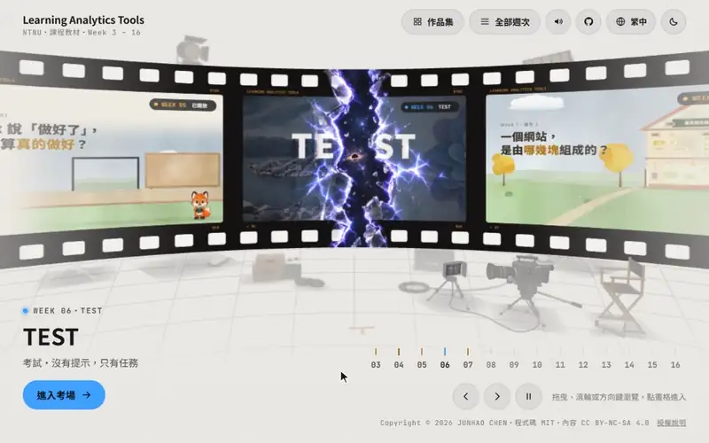

# Learning Analytics Tools (NTNU)

### 👉 [learning-analytics-tools.pages.dev](https://learning-analytics-tools.pages.dev/?lang=zh-Hans)

[English](README.md) ｜ [繁體中文](README.zh-TW.md) ｜ **简体中文** ｜ [日本語](README.ja.md)

[Week 3](https://learning-analytics-tools.pages.dev/weeks/week03/?lang=zh-Hans) ・ [Week 4](https://learning-analytics-tools.pages.dev/weeks/week04/?lang=zh-Hans) ・ [Week 5](https://learning-analytics-tools.pages.dev/weeks/week05/?lang=zh-Hans) ・ [Week 6 TEST](https://learning-analytics-tools.pages.dev/weeks/week06/?lang=zh-Hans) ・ [Week 7](https://learning-analytics-tools.pages.dev/weeks/week07/?lang=zh-Hans) ・ [Week 8](https://learning-analytics-tools.pages.dev/weeks/week08/?lang=zh-Hans) ・ [作品集](https://learning-analytics-tools.pages.dev/works/?lang=zh-Hans) ・ 练习电脑 [Mac](https://learning-analytics-tools.pages.dev/lab/mac/) / [Windows](https://learning-analytics-tools.pages.dev/lab/win/)

[](https://learning-analytics-tools.pages.dev/?lang=zh-Hans)

<table>
<tr>
<td width="50%"></td>
<td width="50%"></td>
</tr>
<tr>
<td align="center"><b>Virtual Remote Practice</b></td>
<td align="center"><b>Scenario-Based Exam Practice</b></td>
</tr>
</table>

台师大「学习分析工具」的课程网站：每周几个短视频，配上章节和要点，学生课后可以自己回来复习。授课教师规划内容、审核每一个视频；网站和视频的开发由 Codex 与 Claude 协作完成，视频做好后也由两者互相审查。

## 网站上有什么

- **每周视频**：从 Week 3 开始，每周几个短视频，包括作业说明和补充教材。每个 1–5 分钟，没有旁白，用动画和字卡讲解。视频里的文字是繁体中文，标题、章节和要点都有简体中文翻译。
- **情境式考试（Week 6）**：首页的「TEST」入口。连接到一台远程电脑（Mac 或 Windows），没有提示，只有任务，一关一关靠自己完成。
- **虚拟远程练习**：在浏览器里的模拟 Mac／Windows，每周同一台、换那周的任务，照着任务卡动手做，弄坏了重来就好。
- **作品集**：学生同意公开的作业网页。
- 不用登录、不用 cookie，观看进度只保存在自己的浏览器。网站只用 Cloudflare Web Analytics 统计各页面的浏览次数，不识别个人。界面有繁中、简中、English、Tiếng Việt，深浅色都可以。

## 视频

| 周 | 视频 | 时长 |
|---|---|---|
| Week 3 | [01 report.md 的旅程](https://learning-analytics-tools.pages.dev/weeks/week03/?lang=zh-Hans#01-report-journey) | 1:33 |
| | [02 AGENTS.md 与上下文管理](https://learning-analytics-tools.pages.dev/weeks/week03/?lang=zh-Hans#02-agents-md-context) | 3:40 |
| | [03 作业：佛罗伦萨美术馆数据收集](https://learning-analytics-tools.pages.dev/weeks/week03/?lang=zh-Hans#03-homework-firenze) | 2:55 |
| | [补充 1 终端介绍（Mac）](https://learning-analytics-tools.pages.dev/weeks/week03/?lang=zh-Hans#s1-terminal-mac)・[补充 2（Windows）](https://learning-analytics-tools.pages.dev/weeks/week03/?lang=zh-Hans#s2-terminal-win) | 5:14・5:23 |
| Week 4 | [01 AI Agent 内置浏览器](https://learning-analytics-tools.pages.dev/weeks/week04/?lang=zh-Hans#01-built-in-browser) | 2:28 |
| | [02 内置浏览器的三件事：看、改、查](https://learning-analytics-tools.pages.dev/weeks/week04/?lang=zh-Hans#02-browser-uses) | 2:52 |
| | [03 作业：东京银杏散步地图网站](https://learning-analytics-tools.pages.dev/weeks/week04/?lang=zh-Hans#03-homework-ginkgo) | 2:27 |
| | [04 作业：GitHub、Mermaid、内置浏览器](https://learning-analytics-tools.pages.dev/weeks/week04/?lang=zh-Hans#04-homework-github) | 3:23 |
| | [补充 1 GitHub 入门](https://learning-analytics-tools.pages.dev/weeks/week04/?lang=zh-Hans#s1-github)・[补充 2 Mermaid 流程图](https://learning-analytics-tools.pages.dev/weeks/week04/?lang=zh-Hans#s2-mermaid) | 3:42・4:10 |
| Week 5 | [01 怎样才算做好：验证清单](https://learning-analytics-tools.pages.dev/weeks/week05/?lang=zh-Hans#01-verify-md) | 3:24 |
| | [02 不要一直换模型](https://learning-analytics-tools.pages.dev/weeks/week05/?lang=zh-Hans#02-model-switch) | 1:30 |
| | [03 作业：成绩分析小报告](https://learning-analytics-tools.pages.dev/weeks/week05/?lang=zh-Hans#03-homework-grades) | 2:29 |
| | [补充 1 按下 Enter 之后](https://learning-analytics-tools.pages.dev/weeks/week05/?lang=zh-Hans#s1-codex-loop)・[补充 2 对话满了会怎样](https://learning-analytics-tools.pages.dev/weeks/week05/?lang=zh-Hans#s2-context-full) | 3:44・2:35 |
| Week 6 | [TEST](https://learning-analytics-tools.pages.dev/weeks/week06/?lang=zh-Hans)（不是视频，是连接到远程电脑的考试） | — |
| Week 7 | [01 软件工程与测试驱动开发（TDD）](https://learning-analytics-tools.pages.dev/weeks/week07/?lang=zh-Hans#01-se-tdd) | 3:24 |
| | [02 大任务，先规划：PLANS.md](https://learning-analytics-tools.pages.dev/weeks/week07/?lang=zh-Hans#02-plans) | 4:08 |
| | [03 作业：规划并做出“空中之岛”](https://learning-analytics-tools.pages.dev/weeks/week07/?lang=zh-Hans#03-homework-island) | 2:52 |
| | [补充 1 网站是怎么组成的](https://learning-analytics-tools.pages.dev/weeks/week07/?lang=zh-Hans#s1-website-modules)・[补充 2 Git：版本管理，也是你的安全网](https://learning-analytics-tools.pages.dev/weeks/week07/?lang=zh-Hans#s2-git-versions) | 3:51・2:57 |
| Week 8 | [01 VERIFY 写好了，这样就测够了吗？TESTS.md](https://learning-analytics-tools.pages.dev/weeks/week08/?lang=zh-Hans#01-tests) | 3:46 |
| | [02 测试全部通过，就代表测得好吗？故意弄坏一行](https://learning-analytics-tools.pages.dev/weeks/week08/?lang=zh-Hans#02-break) | 2:58 |

**涵盖主题**：AI 编程助手（OpenAI Codex、Claude Code）、工作文件夹与终端、`AGENTS.md` 与上下文窗口、内置浏览器、GitHub 与 Mermaid、验证清单（`VERIFY.md`）、做到一半换模型（GPT-6 Luna → GPT-6.1 Sol）、Codex 的 agent loop 与自动压缩、测试驱动开发、`PLANS.md` 与 `TESTS.md`。

## 怎么做的

- **分工**：教师提供教材、决定方向，每一轮都审核。网站和视频的开发由 Codex 与 Claude 协作完成。
- **画面和声音都是代码**：每一帧画面都是用 HTML、CSS、JavaScript 写成的网页，逐帧渲染成视频，用到 HyperFrames、GSAP、Playwright、FFmpeg；制作流程主要参考 opus-video skill，再根据课程需求做了个性化修改。配乐和音效也用代码合成。没有使用视频生成模型。
- **互相审查**：视频做好后，由 Codex 与 Claude 互相审查流程、讲解是否清楚和画面细节，教师最后确认才上线。
- **网站**：纯静态网站，部署在 Cloudflare Pages；视频以 HLS（hls.js）从另一个 Cloudflare 视频站播放。

完整说明见 [docs/about.md](docs/about.md)（繁体中文、英文）。

## 用在自己的课程

网站是纯 HTML、CSS、JavaScript，不需要构建，可以直接 fork：

```bash
git clone https://github.com/bigmoumou/Learning-Analytics-Tools.git
cd Learning-Analytics-Tools
python -m http.server 8000
```

视频的流媒体文件不在这个仓库里，放在另一个 Cloudflare 项目（视频站），所以 fork 之后视频会从本课程的视频站播放。换成自己的视频时，要改 `assets/video.js` 里的 `MEDIA`。其他需要修改的地方见 [docs/維護說明.md](docs/維護說明.md)（繁体中文）。

## 接下来

- [ ] 之后的周次按课程进度上线（到 Week 16）
- [ ] 全英文版视频：画面上的文字和字卡都改成英文（目前视频里是繁体中文，网站界面、章节和要点已有英文）
- [ ] Claude 版视频：同样的内容，改用 Claude（Claude Code）演示（目前视频演示的工具是 Codex）
- [ ] 开源这套教学视频 skill（主要参考 opus-video，再做个性化修改），以及制作用的 prompt（每个视频的 `brief.md`、动画素材规格）和制作经验

## 授权

- 代码：[MIT](LICENSE)
- 视频与教材：[CC BY-NC-SA 4.0](LICENSE-CONTENT.md)（署名、非商业性使用、相同方式共享）
- 学生作品：著作权属于学生本人
- 第三方组件与图片：见 [NOTICE.md](NOTICE.md)

引用方式见 [CITATION.cff](CITATION.cff)。问题和建议请开 [Issue](https://github.com/bigmoumou/Learning-Analytics-Tools/issues)，请不要写出学生的姓名或学号。

## 作者与致谢

- **作者**：陈俊豪（维护者，[@bigmoumou](https://github.com/bigmoumou)）、刘哲佑、邱嵦时
- **参与助教与学生**：许家玮（台湾师范大学资讯教育研究所）
- **资源支持**：感谢台湾大学生物环境系统工程学系[许少瑜教授](https://www.bse.ntu.edu.tw/member/teacher/syhsu)的 [MPIPM 研究室](https://shaoyiuhsu.wixsite.com/website)（孔隙介质多相流研究室）提供资源支持

网站和视频与 [Codex](https://openai.com/codex/)（OpenAI）、[Claude Code](https://claude.com/claude-code)（Anthropic）协作完成。视频的制作流程主要参考周行（Kianzzz）的 opus-video skill，再根据课程需求做了个性化修改；这套教学视频 skill 之后也会开源。感谢修课的同学。
